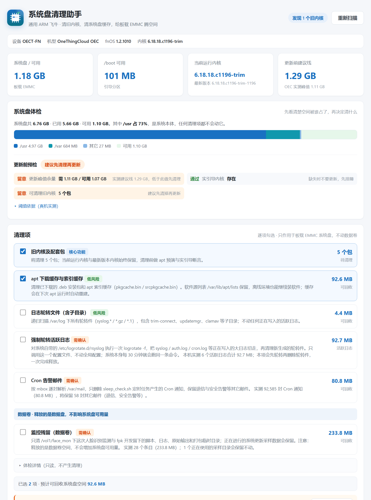
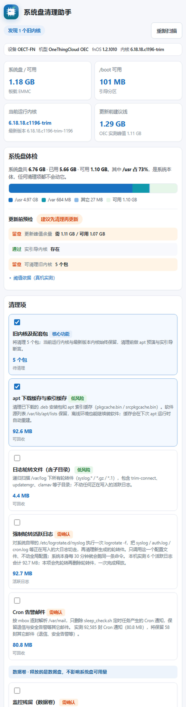
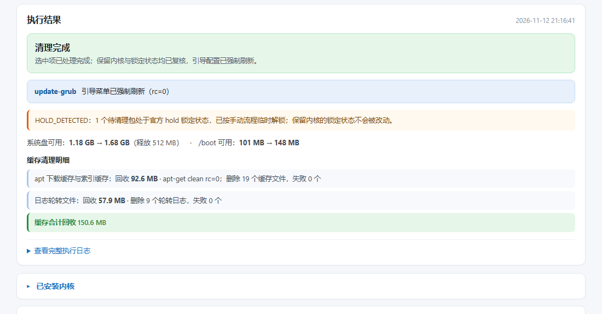

<div align="center">

# 系统盘清理助手 · fncleankernel

**通用 ARM 版飞牛 fnOS 的「系统盘体检 + 逐项清理」第三方应用 —— 给板载 EMMC 腾空间。**
**与飞牛官方无关，是社区开发者做的小工具。**


作者：[很多问题的小明同学](https://github.com/gulugulupao) · 公众号：很多问题的小明同学

[下载安装包 v1.7.1](https://github.com/gulugulupao/fncleankernel/releases/download/v1.7.1/fncleankernel-V1.7.1.fpk) · [使用说明](使用说明.md) · [Release](https://github.com/gulugulupao/fncleankernel/releases)

</div>

---

## 界面一览

体检先行、逐项勾选、结果可查 —— 一个页面把「看清楚 → 勾选 → 一键清理 → 看结果」走完。

<table>
<tr>
<td width="50%" align="center"><b>桌面端</b></td>
<td width="50%" align="center"><b>手机端（自动窄屏排版）</b></td>
</tr>
<tr>
<td align="center"></td>
<td align="center"></td>
</tr>
</table>

<details>
<summary>🖼️ 点开看：清理执行结果（update-grub 栏 + 缓存明细）</summary>



结果页用颜色区分状态：绿色成功、橙色需留意、红色失败。`update-grub` 栏单独展示引导菜单是否刷新成功；「缓存清理明细」逐项列出实际回收量；展开「查看完整执行日志」可看全过程。

</details>

<details>
<summary>📱 点开看：公众号二维码弹窗</summary>

<div align="center">

</div>

页面底部点「公众号」即可弹出，右上角叉号、点空白处、按 Esc 都能关闭。

</details>

---

## 它解决什么问题

飞牛系统更新、日常使用会在系统盘（`/`，板载 EMMC）上堆积旧内核、apt 下载缓存、轮转/活跃日志、Cron 告警邮件等。
系统盘空间本来就小，攒多了会提示「空间不足」，甚至下次系统更新都装不上。

这个工具把整个过程做成一个带网页界面的应用：

| 特性 | 说明 |
| --- | --- |
| 🔍 体检先行 | 空间构成条一眼看清 `/usr` 占了多少；「更新前建议线 1.29 GB」来自真机跟测；存储空间只读体检 |
| ☑️ 逐项勾选 | 旧内核、apt 缓存、日志轮转、活跃日志强制轮转、Cron 邮件、监控残留 —— **扫描时显示真机实测大小**，中风险项需二次确认 |
| 🛡️ 只清系统盘 | 清理项都作用于 `/` 所在文件系统，**绝不碰数据卷**；`/vol*` 只读体检（唯一例外「监控残留」只清自有产物、保留在用采样目录） |
| 📜 历史可查 | 每次清理落一条记录：趋势图 + 上次结果 + 完整日志 + 一键复制诊断信息 |
| ⚙️ 铁律收尾 | **仅当勾选「旧内核及配套包」（涉及内核包变更）时**，无论成功/失败/异常都强制执行 `sudo update-grub`；只清缓存则跳过并写明原因 |

---

## 安全边界（为什么敢用）

- **永远保留**：当前运行内核 + 版本号最高的已安装内核 + 所有 meta 包。
- **apt 预演白名单**：`apt-get -s purge` 计划里只要碰到保留包，立即 `UNSAFE_PLAN` 中止。
- **实引导链路断言**：读取设备**真实**的开机引导配置，确认要删的内核不是正在引导的那一个；解析不出引导版本就 fail-closed 中止，绝不默认放行。
- **hold 内核自动处理**：飞牛官方会把内核包 `apt-mark hold` 锁定。工具只对**待清理包**临时 `unhold`，purge 后把仍安装、原本 hold 的**保留内核**恢复锁定，绝不留「半解锁」状态 —— 所以「hold」不是清理障碍，也不需要手动解锁。
- **跨设备识别**：机型名只读设备自身声明（`/proc/device-tree/model` → `board.json model.name`），未识别就省略而不猜；识别字段**不参与任何清理判断**。
- **接口安全**：写接口（清理 / 堵邮件源头）有同源校验 + 执行确认，别的网站或脚本直接调用会被拒绝；未确认的 cron 堵源接口不回显 crontab 原文。

<details>
<summary>⚠️ 风险提示（安装前请展开阅读）</summary>

工具会通过 `apt/dpkg` 卸载系统内核包并重写 `/boot/grub/grub.cfg`。
误用、断电、固件异常或在引导已损坏的设备上运行，**可能导致设备无法启动**。
安装使用前请确认：已备份关键数据、已了解如何通过 SSH/串口进入设备、设备当前运行内核可正常启动。

</details>

---

## 安装

1. 到 [Releases](https://github.com/gulugulupao/fncleankernel/releases) 下载最新版 `fncleankernel-V1.7.1.fpk`（文件名带版本号，方便区分版本）。
2. 飞牛桌面「应用中心」→ 右上角「手动安装」→ 选择该文件。
3. 装好后点「系统盘清理助手」打开，手机浏览器也能用（页面自动排成窄屏版式）。

详细使用说明见 [使用说明.md](使用说明.md)。适用：网心云 OEC（RK3566）/ OES（A311D）等 ARM 版飞牛 fnOS，`os_min_version = 0.9.25`。

---

<details>
<summary>📦 仓库内容</summary>

```
fncleankernel-V1.7.1.fpk  构建好的安装包（文件名含版本号，与 Releases 中一致）
src/fncleankernel/        应用源码（fpk 工程）：引擎 kernel_clean.py、Web 后端 server.py、前端、图标、脚本、manifest
screenshots/              README 中展示的界面截图
build_fpk.py              构建/部署脚本（上传工程 → 设备只读验证 → 设备上 fnpack build → 回传核验）
test_branches.py          错误分支单元测试（进程内 monkeypatch，覆盖状态分类 + update-grub 铁律）
使用说明.md               面向用户的使用说明
LICENSE.txt               MIT 许可证 + 附加保护条款（中英文对照）
```

</details>

<details>
<summary>⌨️ 命令行入口（SSH 手动清理习惯）</summary>

安装脚本会注册 `kclean` 命令：

```bash
kclean scan        # 只读体检
kclean dry-run     # 预演（不卸载、不刷引导）
kclean clean       # 真正清理（默认只跑旧内核；前端会显式传入完整勾选项）
```

</details>

<details>
<summary>🔨 构建说明（开发者）</summary>

`build_fpk.py` 负责把 `src/fncleankernel/` 打成 fpk 并在真机上验证：上传工程 → 两台设备只读验证（scan/dry-run）→ OEC 上 `fnpack build` → 回传并解包核验。
文件名版本号由 `manifest` 的 `version` 字段自动生成（`fncleankernel-V<version>.fpk`），每版无需手改。
脚本里 `BASE` 是作者本机工作目录，克隆后按需改成自己的路径（构建发生在 ARM 设备侧，本机只负责上传与回传）。

</details>

---

MIT 许可证 + 附加保护条款（中英文对照），详见 [LICENSE.txt](LICENSE.txt)。
版权所有 © 2026 很多问题的小明同学（GitHub @gulugulupao）。
